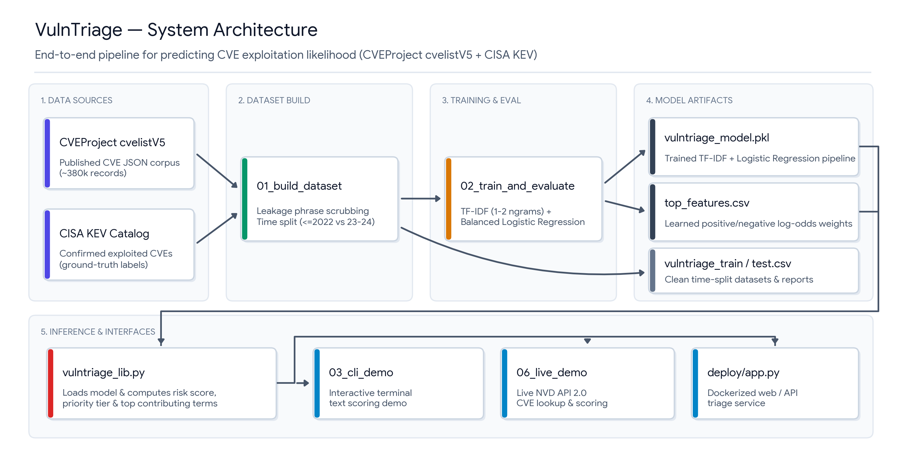

# VulnTriage

ML model that predicts which software vulnerabilities (CVEs) are likely to be
actively exploited, trained on the public CVE corpus and CISA's Known
Exploited Vulnerabilities (KEV) catalog. Benchmarked against CVSS-only
prioritization using a time-based train/test split.

**Result:** at a 5%-of-backlog review budget, the model catches 48% of CVEs
that go on to be exploited, versus 20% for CVSS-only ranking (~2.4x). Full
methodology and limitations in `dataset_report.md` and `model_report.md`.

## Why this exists

CVSS measures how severe a vulnerability would be if exploited, not how
likely it is to actually be attacked. Security teams get thousands of new
CVEs a year and can't patch them all -- this model predicts exploitation
likelihood directly from the vulnerability description, using CISA's KEV
catalog as ground truth.

## Architecture



## Project structure

```text
01_build_dataset.py        Parses the CVE corpus, labels with KEV, removes leakage, splits by time
02_train_and_evaluate.py   Trains TF-IDF+LogReg / Random Forest, benchmarks against CVSS
03_cli_demo.py             Terminal demo
04_generate_visuals.py     Generates evaluation plots and class distribution figures
05_triage_dashboard.py     Single + batch (CSV backlog) Flask dashboard
06_live_demo.py            Fetches a real CVE from the NVD API and scores it live
vulntriage_lib.py          Shared scoring and explainability logic
deploy/                    Dockerized app, ready for Hugging Face Spaces
```

`vulntriage_model.pkl`, `vulntriage_test.csv`, `dataset_report.md`,
`model_report.md`, `top_features.csv`, and `architecture.png` are pre-built and
included, so the demos run immediately without retraining.

## Setup

```bash
pip install flask scikit-learn pandas numpy
```

## Run a demo

```bash
python 05_triage_dashboard.py          # http://127.0.0.1:5000 -- single CVE + batch backlog ranking
python 03_cli_demo.py                  # terminal version, no browser needed
python 06_live_demo.py CVE-2024-3400   # fetch a real CVE from NVD and score it live
```

For the batch tab in `05_triage_dashboard.py`: paste several descriptions (one
per line) or upload a CSV with a `description` column. `sample_backlog.csv` is
included as a ready-made example.

## Rebuilding from scratch

Only needed if you want fresh data (e.g. recently-added KEV entries) or want
to modify the pipeline.

```bash
mkdir raw
curl -L -o raw/cvelist.zip https://codeload.github.com/CVEProject/cvelistV5/zip/refs/heads/main
curl -L -o raw/kev.json https://www.cisa.gov/sites/default/files/feeds/known_exploited_vulnerabilities.json

python 01_build_dataset.py      # ~1-3 min, builds vulntriage_train/test.csv
python 02_train_and_evaluate.py # ~30s, trains and writes model_report.md
```

On Windows PowerShell, use `curl.exe` instead of `curl` (plain `curl` is an
alias for a different command there).

The raw CVE corpus is ~650MB with no smaller official bulk source (NVD
deprecated its JSON feeds in Dec 2023). Only the training split is
downsampled after parsing -- the test set stays full-size so evaluation
metrics stay realistic. See `dataset_report.md` for details.

## Deployment

`deploy/` contains a self-contained Docker setup for Hugging Face Spaces:

1. Create a Space at huggingface.co, SDK: Docker.
2. Upload the 6 files in `deploy/`.
3. It builds automatically; live in a few minutes.

## Live validation

`06_live_demo.py` can be pointed at any CVE ID, including ones disclosed after
this model's training (<=2022) and test (2023-2024) windows, as a check
against memorization rather than genuine prediction.
